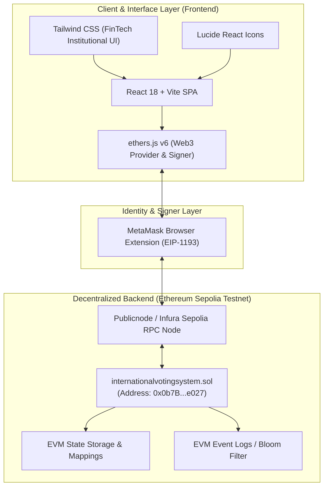
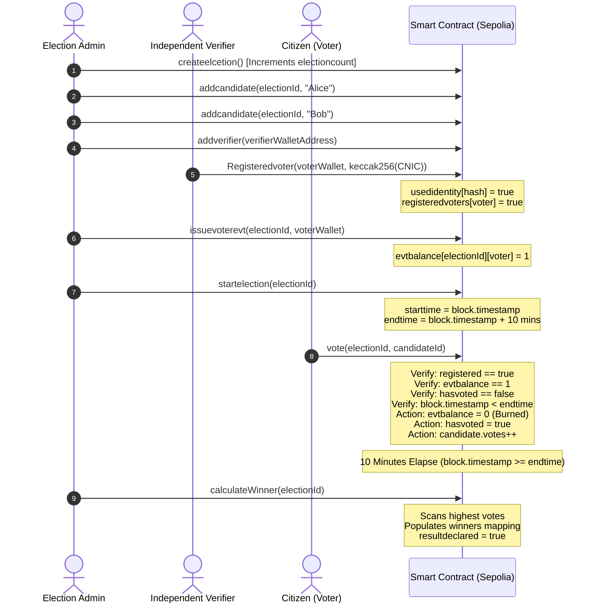

# SOFTWARE REQUIREMENTS SPECIFICATION (SRS)
## Project: Decentralized International E-Voting System (DApp)

---

## 1. Executive Summary & Project Overview
The **Decentralized International E-Voting System** is an institutional-grade, blockchain-powered democratic governance platform deployed on the Ethereum Sepolia testnet. Traditional electronic voting architectures suffer from single-point-of-failure vulnerabilities, central database tampering, administrative coercion, and lack of verifiable transparency. 

This platform eliminates central trust by encoding election rules directly into an immutable EVM smart contract (`internationalvotingsystem.sol`). It enforces a zero-trust, role-segregated architecture comprising:
1. **Government/Electoral Administrator (Admin):** Manages election lifecycles and appoints trusted verifiers.
2. **Authorized Independent Verifiers:** Cryptographically register voters using one-way identity hashing.
3. **Verified Citizens (Voters):** Receive single-use, non-transferable Election Voting Tokens (EVT) and cast cryptographic ballots.

---

## 2. System Architecture & Tech Stack



### 2.1 Frontend Stack & Tools
- **Framework:** React 18 (Functional Components, Hooks: `useState`, `useEffect`, `useCallback`).
- **Build Tool & Bundler:** Vite 5 (Lightning-fast HMR, optimized ESM production builds).
- **Web3 Integration:** `ethers.js` (v6.13) for contract abstraction, JSON-RPC queries, ABI encoding, gas estimation, and transaction lifecycle monitoring.
- **Styling Architecture:** Tailwind CSS v3 with custom CSS classes (`.gov-card`, `.btn-primary`, `.progress-ring__circle`) implementing an institutional FinTech aesthetic (Emerald `#059669` and clean Slate `#f8fafc`).
- **Iconography:** `lucide-react` for clean micro-visual indicators.
- **Visual Feedback:** `canvas-confetti` for celebratory triggers on successful ballot submission and election certification.

### 2.2 Backend & Smart Contract Stack
In pure decentralized Web3 DApps, the blockchain replaces the traditional centralized backend (Node.js/Django/PHP + PostgreSQL/MySQL):
- **Core Language:** Solidity `^0.8.0` (Native overflow/underflow protection).
- **Execution Engine:** Ethereum Virtual Machine (EVM) on Sepolia Testnet (Chain ID: `11155111`).
- **Compilation & Deployment Framework:** Hardhat Ignition (`@nomicfoundation/hardhat-ignition`).
- **Contract Address:** `0x0b7B84172C379e76cB9AEdd519A9fdb01319e027`.
- **Node Infrastructure:** Multi-endpoint fallback RPC (`https://ethereum-sepolia-rpc.publicnode.com` and `https://rpc.sepolia.org`).

---

## 3. Core Roles & Access Control Mechanics

The smart contract uses strict Solidity function modifiers to segregate powers so no single entity can rig an election:

```
+-------------------------------------------------------------------------------+
|                             SYSTEM ACTORS & PERMISSIONS                       |
+---------------------+---------------------------------------------------------+
| Role                | On-Chain Permissions                                    |
+---------------------+---------------------------------------------------------+
| Admin (Deployer)    | 1. addverifier(address) / removeverifier(address)       |
|                     | 2. createelcetion()                                     |
|                     | 3. addcandidate(electionId, name)                       |
|                     | 4. withdrawcandidate(electionId, candidateId)           |
|                     | 5. issuevoterevt(electionId, voterAddress)              |
|                     | 6. startelection(electionId)                            |
+---------------------+---------------------------------------------------------+
| Verifier            | 1. Registeredvoter(voterAddress, hashIdentity)          |
+---------------------+---------------------------------------------------------+
| Voter (Citizen)     | 1. vote(electionId, candidateId)                        |
+---------------------+---------------------------------------------------------+
| Public / Anyone     | 1. calculateWinner(electionId) (after endtime)          |
|                     | 2. View candidates, timers, live votes, and logs        |
+---------------------+---------------------------------------------------------+
```

### 3.1 Role 1: Administrator (`onlyadmin`)
- Set automatically during contract deployment (`admin = msg.sender`).
- Acts as the election commission coordinator.
- **Limitation:** The Admin *cannot* register voters or cast votes on behalf of voters. The Admin *cannot* alter candidate votes.

### 3.2 Role 2: Verifier (`onlyverifier`)
- Independent verification agents authorized by Admin via `addverifier()`.
- Responsible for KYC/Citizen identification before issuing voter credentials.
- **Limitation:** Verifiers *cannot* issue EVT voting tokens and *cannot* create elections or start the countdown timer.

### 3.3 Role 3: Registered Citizen (Voter)
- Verified by an authorized verifier with a unique identity hash.
- Holds exactly 1 non-transferable EVT token per election.
- Casts a direct, self-signed ballot through their Web3 wallet.

---

## 4. End-to-End Operational Workflow (How Voting Works)



### Step 1: Election Initialization
1. Admin calls `createelcetion()`. The global variable `electioncount` increments (e.g. from 0 to 1).
2. Admin registers candidates via `addcandidate(_electionid, _name)`. Each candidate receives an auto-incremented ID and is flagged `active = true`. Candidates can only be added before the election starts (`e.starttime == 0`).
3. If a candidate drops out before election kickoff, Admin calls `withdrawcandidate()`, which sets `c.active = false` and decrements `activecandidates`.

### Step 2: Voter Verification & Cryptographic Hashing
1. Citizen presents off-chain official identification (National ID card / CNIC / Passport number).
2. Verifier submits citizen's Ethereum wallet address and identity string into the **Verifier Portal**.
3. The frontend hashes the identity string via **Keccak-256**:
   $$\text{hashIdentity} = \text{keccak256}(\text{identityString})$$
4. Verifier executes `Registeredvoter(_voter, _hashidentity)`.
5. The contract permanently writes:
   - `registeredvoters[_voter] = true`
   - `usedidentity[_hashidentity] = true`
6. If someone tries to register the same National ID with a different wallet, transaction reverts with `"Already used"`.

### Step 3: EVT Token Issuance
1. Admin verifies that the voter is registered in the system.
2. Admin executes `issuevoterevt(_electionid, _voter)`.
3. Contract sets `evtbalance[_electionid][_voter] = 1`.
4. The voter is now funded with exactly 1 ballot token for that specific election session.

### Step 4: Election Kickoff & Precision 10-Minute Window
1. Admin triggers `startelection(_electionid)`.
2. Contract requires at least one active candidate (`e.activecandidates > 0`).
3. Contract locks the timestamps:
   - `e.starttime = block.timestamp;`
   - `e.endtime = block.timestamp + 10 minutes;`
4. The frontend detects `starttime > 0` and launches the **SVG Circular Countdown Timer** with a 600-second live bar.

### Step 5: Ballot Casting & EVT Token Burn
1. Citizen connects their registered MetaMask wallet.
2. Citizen reviews the Candidate Roster and clicks **"Vote Candidate"**.
3. Contract executes 7 strict sequential checks:
   - Is sender registered? `registeredvoters[msg.sender] == true`
   - Does sender have an EVT token? `evtbalance[_electionid][msg.sender] == 1`
   - Has sender already voted? `!hasvoted[_electionid][msg.sender]`
   - Has election started? `e.starttime > 0`
   - Is election still within 10-minute window? `block.timestamp < e.endtime`
   - Has result already been declared? `!e.resultdeclared`
   - Is candidate active? `c.active == true`
4. **Token Burning & Vote Increment:**
   ```solidity
   evtbalance[_electionid][msg.sender] = 0;   // Token Burned
   hasvoted[_electionid][msg.sender] = true;  // Double-vote Prevention
   c.votes++;                                 // Vote Incremented
   emit evtburned(_electionid, msg.sender);
   emit votecasted(_electionid, msg.sender, _candidateid);
   ```

### Step 6: Winner Calculation & Certification
1. Once 10 minutes pass (`block.timestamp >= e.endtime`), voting automatically freezes on the blockchain. Any late `vote()` calls revert.
2. Any user or Admin calls `calculateWinner(_electionid)`.
3. The contract runs an on-chain search for the highest votes:
   ```solidity
   for (uint256 i = 1; i <= e.totalcandidates; i++) {
       if (candidates[_electionid][i].active && candidates[_electionid][i].votes > e.winningvotes) {
           e.winningvotes = candidates[_electionid][i].votes;
       }
   }
   ```
4. If there is a tie, both candidates are added to the `winners` mapping and `totalwinners` increments.
5. `e.resultdeclared = true;` locks the election permanently.
6. Frontend launches celebratory confetti and displays the official winner(s) banner.

---

## 5. Security Architecture & Threat Modeling

| Threat / Attack Vector | Traditional System Risk | How Our DApp Prevents It |
| :--- | :--- | :--- |
| **Double Voting** | Voters submit multiple paper ballots or spam electronic endpoints. | Protected by dual on-chain guards: `hasvoted` mapping boolean check + `evtbalance` reset to `0` in the same atomic transaction. |
| **Identity Fraud / Sybil Attack** | Generating fake accounts or using fake names to cast multiple votes. | Keccak-256 identity mapping: `usedidentity[hash] = true`. National IDs/Passports cannot be registered twice on the blockchain. |
| **Admin Vote Tampering** | Corrupt database administrators alter vote counts in SQL tables. | Immutability: Solidity contract contains no functions to subtract votes or override `c.votes`. Code is law. |
| **Late Ballot Injection** | Corrupt officials add votes after voting booths close. | Temporal restriction enforced by EVM miners: `require(block.timestamp < e.endtime)`. Even Admin cannot bypass EVM block timestamps. |
| **Unauthorized Token Minting** | Malicious users minting extra voting tokens. | `issuevoterevt()` is guarded with `onlyadmin` modifier and requires voter registration check before issuance. |
| **Vote Buying / Ballot Transfer** | Citizens selling their vote tokens on secondary markets. | Tokens are non-standard ERC-less internal state variables (`evtbalance`), making them completely non-transferable between addresses. |

---

## 6. Real-Time Blockchain Event Subscriptions

The frontend listens directly to Ethereum Bloom filter event logs emitted by the smart contract:

1. `event electioncreated(uint256 electionid);`
2. `event candidateadded(uint256 electiionid, uint256 candidateid);`
3. `event candidatewithdraw(uint electionid, uint256 candidateid);`
4. `event verifieradded(address verifier);`
5. `event verifierremoved(address verifier);`
6. `event voterregistered(address voter);`
7. `event evtissued(uint256 electionid, address voter);`
8. `event evtburned(uint256 electionid, address voter);`
9. `event electionstart(uint256 electionid, uint256 endtime);`
10. `event votecasted(uint256 electionid, address voter, uint256 candidateid);`
11. `event declaredwinner(uint256 electionid, uint256 totalwinners);`

These events power the **Live Contract Events Stream** tab, enabling real-time administrative auditing without requiring page refreshes.

---

## 7. Project File Structure & Deployment Reference

```
F:\SolidityProjects\internationalvoting\
├── index.html                           # HTML5 entry with meta viewport & preconnect fonts
├── package.json                         # Project dependencies (React 18, Vite, Ethers v6, Lucide)
├── vite.config.js                       # Vite bundler configuration (Port 3000, host binding)
├── tailwind.config.js                   # Extended theme (Emerald colors, animations)
├── postcss.config.js                    # PostCSS Tailwind and Autoprefixer integration
├── start.bat                            # Single-click Windows runtime script
├── README.md                            # Complete developer documentation
└── src/
    ├── main.jsx                         # React DOM root mounting
    ├── App.jsx                          # Main DApp logic, Web3 handlers, 4 portal tabs
    ├── index.css                        # Institutional FinTech styling & SVG ring styles
    └── contracts/
        ├── InternationalVotingSystem.sol # Original verified Solidity smart contract
        ├── internationalvotingsystem.json# Official Hardhat Ignition Sepolia artifact & ABI
        └── contractConfig.js             # Deployed address & ABI exports
```

---

## 8. Conclusion
The **E Voting System** represents a zero-compromise implementation of decentralized democracy. By combining Solidity smart contract immutability with an institutional-grade, responsive React 18 interface, the system achieves complete auditability, mathematical security, and transparent electoral governance on the public Ethereum Sepolia network.
